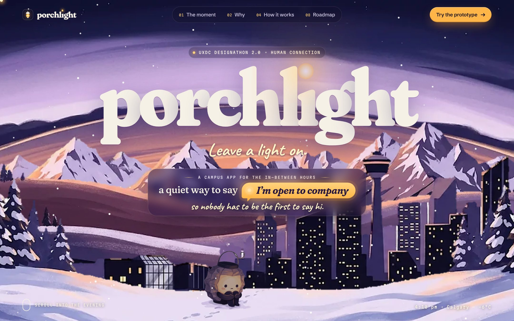
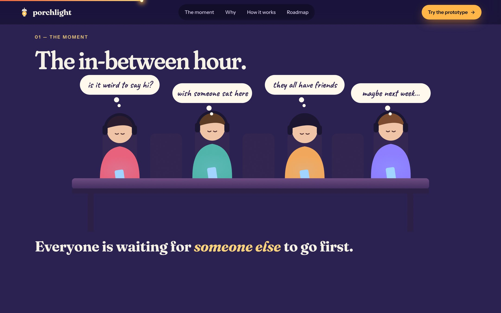
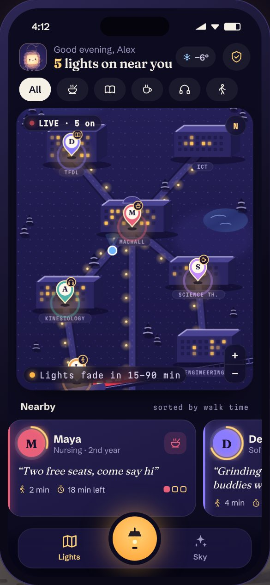
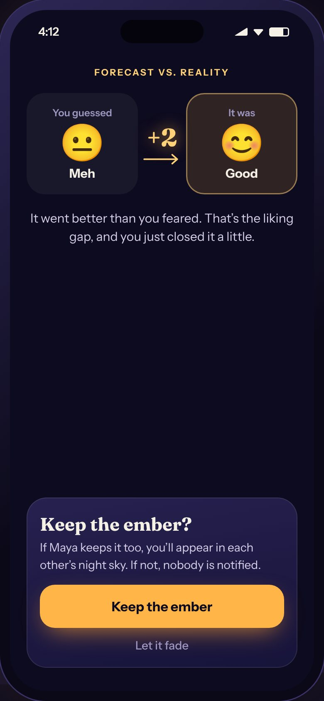
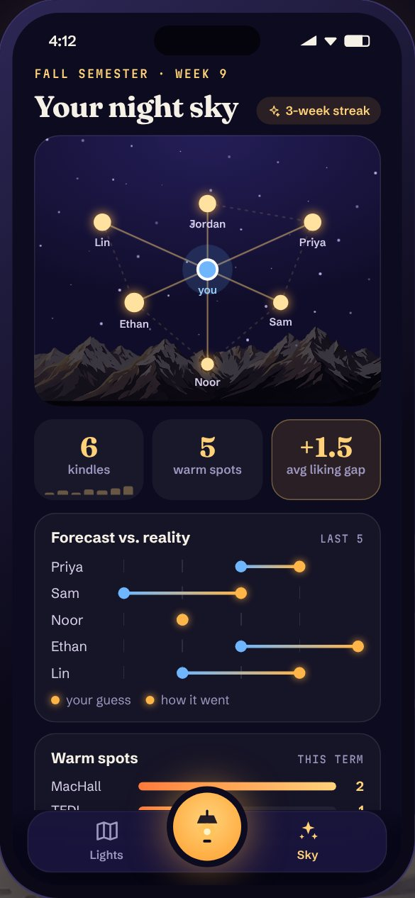

<div align="center">

# porchl<sup>●</sup>ght

### Leave a light on.

A campus app for the in-between hours: a quiet way to say *“I’m open to company,”* so nobody has to be the first to say hi.

**UXDC Designathon 2.0 · Theme: Human Connection · Beginner track**

[**Live story site**](https://viktor-nedev.github.io/porchlight/) · [**Interactive prototype**](https://viktor-nedev.github.io/porchlight/prototype/) · [**Research**](docs/RESEARCH.md) · [**Case study**](docs/CONCEPT.md) · [**Design file (PDF)**](submission/porchlight-design-file.pdf)



</div>

---

## The problem

**4:10 pm, MacHall.** Two hours until your next class, too far to go home. Forty people in the room, zero conversations. Everyone has headphones in, and everyone is waiting for someone else to go first.

| | |
|---|---|
| **69.6%** | of Canadian post-secondary students felt “very lonely” in the past year, **31.2%** in the last two weeks (ACHA-NCHA II, 2019, n = 55,284) |
| **65%** | of University of Calgary students felt very lonely (UCalgary survey cited in Stamp, 2020) |
| **1 in 4** | Canadians aged 15–24 are always or often lonely, the loneliest age group (Statistics Canada, 2021) |
| **≈ 3,000** | residence beds at UCalgary, full three years running, so most students commute and wait out their gaps on campus |

Why it happens: after talking to a stranger, people underestimate how much they were liked (**the liking gap**, Boothby et al., 2018); commuters expect talking to a stranger to be unpleasant but enjoy it more than sitting alone (Epley & Schroeder, 2014); and brief chats with acquaintances measurably improve students’ days (Sandstrom & Dunn, 2014). Students don’t lack the wish to connect. **They lack a signal.**

Full research, competitive analysis and design iterations: [`docs/RESEARCH.md`](docs/RESEARCH.md).



## The solution

**Porchlight lets you switch on a light at your table**: a time-limited, opt-in signal that you’re open to company.

1. **Light your lamp.** Pick a public spot, what you’re up to, and for how long (15–90 min).
2. **See who’s open.** An illustrated night-time campus map glows with every light that’s on.
3. **Make a private guess.** *How do you think this will go?* Only you ever see it.
4. **Walk over with a Spark.** You both get the same conversation starter.
5. **Kindle, then compare.** “You guessed 2, it was 4.” Your own evidence against the fear of going first.
6. **Grow your night sky.** A mutual “keep the ember” adds people to your constellation, and campus fills with warm spots.

| From each other | From a place | From yourself |
|---|---|---|
| **Lights:** an opt-in signal that turns a room of strangers into possible conversations | **Warm spots:** places on campus that start to mean something | **Forecast vs. reality:** a private record that rebuilds trust in yourself |

<p align="center">
  
  
  
</p>

**Safety by design:** campus-email sign-in, first name only, lights snap to ~40 public spots (never GPS or residences), every light expires, “I have to run” on every step, block and report one tap away.

**Feasibility:** installable web app, real-time backend on a free tier (≈ $0–25/month), an illustrated map with no paid API, and 30 acrylic **Lantern Table** tokens (≈ $18 each) so the signal works without a phone. Pilot with two clubs in January 2027, measured with the 3-item UCLA Loneliness Scale.

## Submission

| Required (Beginner track) | Where |
|---|---|
| Presentation: problem, research, solution, design decisions (4 min) | Slides deck (14 slides), exported to PDF/PPTX in the Google Drive folder; script in [`submission/SCRIPT.md`](submission/SCRIPT.md) |
| Walkthrough of the main feature | Slides 8–9 (two user flows) and the [clickable prototype](https://viktor-nedev.github.io/porchlight/prototype/) |
| Design files | [`submission/porchlight-design-file.pdf`](submission/porchlight-design-file.pdf), `assets/img/`, `images/` |
| Extras | Live story site, full codebase, a prototype walkthrough video (`submission/porchlight-demo.mp4`) |

Checklist and Devpost text: [`submission/SUBMISSION.md`](submission/SUBMISSION.md).

## Repository

```
index.html              Story site: scroll-driven case study (dusk → night over Calgary)
prototype/              Interactive mobile prototype (also embedded in the story site)
js/data.js              Editable content: team, links, optional survey results
js/site.js              Motion: GSAP ScrollTrigger, SplitText, Lenis, canvas scenes
css/site.css            Story site styles
assets/img/             Optimised illustrations (cut out, retouched, WebP)
images/                 Original illustration files as generated
docs/RESEARCH.md        Research: sources, competitive analysis, walkthrough, synthesis
docs/CONCEPT.md         Case study: problem, persona, solution, decisions, feasibility
docs/PITCH.md           Slide plan, timing and Devpost text
docs/RESEARCH_KIT.md    Optional student survey and interview kit
docs/IMAGE_PROMPTS*.md  Art direction and every illustration prompt
submission/             Design-file PDF, presentation script, checklist, walkthrough video
```

## Run it locally

No build step. Any static server works:

```bash
python3 -m http.server 8000
```

Then open <http://localhost:8000> for the story site and <http://localhost:8000/prototype/> for the app. Deep links: `prototype/?screen=map` (also `detail`, `forecast`, `onway`, `kindle`, `result`, `sky`, `light-where`, `light-what`, `light-time`, `lit`).

## Design

- **Story:** Wick, a shy paper lantern, waits in the dark until you pull the chain. As you scroll, Calgary turns from dusk to night, the city lights up and Wick glows brighter and finds a friend.
- **Motion:** pull-chain preloader, five-layer painted parallax with a dusk-to-night grade, the “in-between hour” scene, C-Train arrival boards with split-flap text, a lit window opening onto the campus, a sticky phone that drives the live prototype, taped postcards with 3D tilt, an interactive constellation, a horizontal transit-line roadmap and rising lanterns.
- **Prototype:** an illustrated isometric campus map with person pins, time rings and seat indicators, a lantern-face rating scale, a route on the map, a shared Spark card, and a night sky over the Rockies.
- **Type:** Fraunces, Schibsted Grotesk, Martian Mono, Caveat and DotGothic16 on the site; Petrona, Onest, Kalam and Martian Mono in the presentation.
- **Accessibility:** `prefers-reduced-motion` respected, keyboard-operable preloader and prototype, text contrast ≥ 4.5:1, labelled icons.

## Credits

- Illustrations: generated with an AI image tool from the prompts in `docs/IMAGE_PROMPTS.md`, then cut out and retouched for this project. *(Name the tool here and on Devpost, as the event rules require attribution for outsourced illustrations.)*
- Fonts: [Google Fonts](https://fonts.google.com) (SIL Open Font License).
- Motion: [GSAP](https://gsap.com) and [Lenis](https://github.com/darkroomengineering/lenis), vendored in `js/vendor/`.
- Research sources: listed in [`docs/RESEARCH.md`](docs/RESEARCH.md#sources).

## License

Code is released under the [MIT License](LICENSE).
